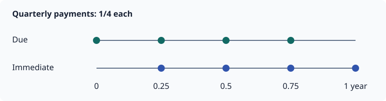

# Insurance and annuities

Textbook products combine a life, an interest assumption and a unit-benefit schedule.
Construct them from `(life, interest, ...)` or from a `LifeContingency`.

## Payment amounts and times

| Product | Payment amount | Scheduled times |
|---|---|---|
| `Insurance(lc, n)` | 1 on death during a covered year | `1:n`, at year end |
| `AnnuityDue(lc, n; frequency=f, start_time=s)` | `1/f` per installment | `s + k/f`, for `k=0:n*f-1` |
| `AnnuityImmediate(lc, n; frequency=f, start_time=s)` | `1/f` per installment | `s + k/f`, for `k=1:n*f` |

Omit `n` for a lifetime product when the mortality assumption supports it. The annuity's
`term` is its payment duration, measured from commencement, not from issue.



```@example products
using LifeContingencies, MortalityTables

life = SingleLife(UltimateMortality([0.5, 0.5, 1.0]; start_age=60))
lc = LifeContingency(life, 0.05)
due = AnnuityDue(lc, 1; frequency=4)
immediate = AnnuityImmediate(lc, 1; frequency=4)
@assert benefit(due) == 0.25
(collect(timepoints(due)), collect(timepoints(immediate)))
```

A monthly annuity pays twelve installments of `1/12` per full year. To model a monthly
amount of 1, multiply its expected cash flows or PV by 12. To model an annual benefit of
12,000 paid monthly, multiply by 12,000.

## Deferral

`start_time` is a whole number of years from issue. Before commencement there are no
annuity payments. The mortality and curve origins remain at issue.

```@example products
deferred = AnnuityDue(lc, 2; start_time=1)
(collect(timepoints(deferred)), probability(deferred), cashflows(deferred))
```

## Guaranteed installments

`certain` is a whole number of years of payments, starting at commencement. At frequency
`f`, it covers the first `certain*f` installments, limited by the term. It does not add
payments before commencement. Those installments are unconditional, even if death occurs
during deferral; later installments require the contingency to be in force.

```@example products
guaranteed = AnnuityDue(lc, 2; start_time=1, certain=1)
@assert probability(guaranteed) ≈ [1.0, 0.25]
@assert probability(AnnuityDue(lc, 2; start_time=1, certain=0)) ≈ [0.5, 0.25]
probability(guaranteed)
```

A due annuity's payment at commencement is its **first** guaranteed installment. A one-year
annual guarantee covers that installment alone. `certain=0` guarantees none.

Guarantees survive extinction and observed death:

```@example products
dead = SingleLife(life.mortality; alive=false)
guaranteed_dead = AnnuityDue(dead, 0.0, 3; certain=2)
@assert cashflows(guaranteed_dead) == [1.0, 1.0, 0.0]
cashflows(guaranteed_dead)
```

## Inspect a product

| View | Meaning |
|---|---|
| `timepoints(ins)` | Dates of scheduled payments, as durations from issue |
| `benefit(ins)` | Unit amount: 1 for insurance, `1/frequency` for annuities |
| `probability(ins)` | Probability each benefit is payable; 1 for guarantees |
| `cashflows(ins)` | Expected amounts: `benefit(ins) .* probability(ins)` |
| `discount(ins)` | Issue-date discount factor at each payment date |
| `survival(ins)` | In-force probability at each year's **start** for insurance, or at each payment date for annuities |

`survival(ins)` need not equal `probability(ins)`: death insurance pays on a transition, and
an annuity guarantee does not require survival. `survival(ins, t)` always evaluates the life's
contingency at duration `t`.

```@example products
ins = Insurance(lc)
@assert cashflows(ins) ≈ benefit(ins) .* probability(ins)
@assert present_value(ins) ≈ sum(cashflows(ins) .* discount(ins))
collect(zip(timepoints(ins), survival(ins), probability(ins), cashflows(ins)))
```

The numeric views are vectors in 3.0. `timepoints` is a range; call `collect` when a concrete
vector is needed.

## Zero duration and invalid inputs

A zero term produces an empty schedule and expected stream, with PV zero. Negative or
fractional terms error. `frequency` must be a positive integer; `certain` and `start_time`
must be nonnegative integers. All three keyword quantities are in years or payments per
year as described above.

```@example products
empty_insurance = Insurance(lc, 0)
@assert isempty(cashflows(empty_insurance))
@assert present_value(empty_insurance) == 0
(collect(timepoints(empty_insurance)), cashflows(empty_insurance), present_value(empty_insurance))
```

A term ending past mortality support is allowed only where extinction supplies the needed
continuation. See [Mortality support](@ref mortality-support).
