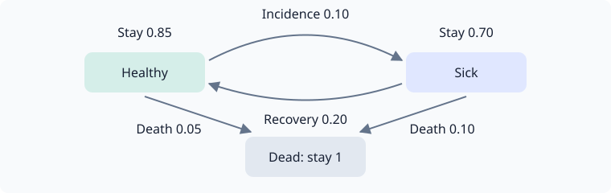

# Building multi-state models

`LifeContingencies.Experimental` projects expected payments and computes policy values on
finite-state models. A state contains everything needed to determine future transitions
and payments. Recovery is allowed; the core has no universal definition of “in force”.

The interface is experimental and may change in minor releases.

## A three-state model

Here a policyholder can be healthy, sick or dead. The one-year transition matrix is

```math
P=\begin{pmatrix}
0.85 & 0.10 & 0.05\\
0.20 & 0.70 & 0.10\\
0 & 0 & 1
\end{pmatrix}.
```

Rows are starting states; columns are destinations in the order Healthy, Sick, Dead.



Supply sparse rows as iterables of `next_state => probability`. Each call must return the
same row for the same arguments; the engine can request it more than once. A fresh
single-pass iterator is also valid.

```@example engine
using LifeContingencies
using LifeContingencies.Experimental

struct RecoveryModel end
LifeContingencies.Experimental.states(::RecoveryModel) = (:healthy, :sick, :dead)
function LifeContingencies.Experimental.transitions(::RecoveryModel, interval::Interval, state::Symbol)
    interval.stop - interval.start == 1 || throw(ArgumentError("this model supports one-year steps"))
    state === :healthy && return (:healthy => 0.85, :sick => 0.10, :dead => 0.05)
    state === :sick && return (:healthy => 0.20, :sick => 0.70, :dead => 0.10)
    state === :dead && return (:dead => 1.0,)
    throw(ArgumentError("unknown state $state"))
end
model = RecoveryModel()
```

State labels must have a common type. Typed, hashable structs are useful when a state
includes counters; the [LTC example](ltc.md) does this. `states(model)` is optional. Without
it, forward projection discovers states from `initial`, and policy valuation needs explicit
`roots`. A tuple returned by `states` also supplies the engine's index for a small model.

## Name the payment components

A contract is a `NamedTuple` of `StatePayment`, `TransitionPayment` and `CertainPayment`
components. The empty contract is `(;)`. Payment functions return signed amounts: here
benefits are positive and premiums negative, so the sum is an insurer's net liability.

| Component | Function | Settlement |
|---|---|---|
| `StatePayment(f)` | `f(time, state)` | At each grid time, in the occupied state |
| `TransitionPayment(f)` | `f(interval, from, to)` | At `interval.stop`, including self-loops |
| `CertainPayment(times, amounts)` | Explicit dated amounts | At its own dates, regardless of state |

This one-year contract collects 10 now from a healthy policyholder, pays 100 if sick at year
end, and pays 1,000 on death during the year:

```@example engine
contract = (
    premium = StatePayment((t, s) -> t == 0 && s === :healthy ? -10.0 : 0.0),
    care = StatePayment((t, s) -> t == 1 && s === :sick ? 100.0 : 0.0),
    death = TransitionPayment((interval, from, to) -> interval.stop == 1 && from !== :dead && to === :dead ? 1_000.0 : 0.0),
)
grid = 0:1
initial = [:healthy => 1.0]
curve = 0.05
```

## Project forward

```@example engine
projection = project(contract, model; grid, initial, history=true)
@assert sum(values(projection.final)) ≈ 1.0
@assert projection.final[:sick] ≈ 0.10
projection.cashflows
```

`cashflows` has one vector of dated `FinanceCore.Cashflow`s per component. State components
include every grid time, transition components every interval end. `final` is the occupancy
distribution at the last time. `history=true` also returns occupancy at each grid time.
These are expected amounts; individual paths have different payments.

The expected care and death payments at year end are 10 and 50. Their total PV, less the
premium at issue, is ``-10+(10+50)/1.05``:

```@example engine
pv = present_values(contract, model, curve; grid, initial)
@assert sum(pv) ≈ -10 + (10 + 50) / 1.05
pv
```

Use `present_values` when you need component PVs without retaining cash flows or occupancy
history. Occupancy and amounts default to `Float64`; pass `numbertype=BigFloat` for higher
precision, with compatible input probabilities and payment functions.

## Policy values and payment phases

At a grid date `t`, incoming transition payments have already settled. The `before` value
``V^-(t)`` includes state payments at `t`; `after`, or ``V^+(t)``, excludes them. Certain
payments at `t` follow the same before/after distinction.

For a state or transition component, write ``b_k(i)`` for its state payment and
``r_k(i,j)`` for its edge payment. Backward valuation uses

```math
V^-_k(i)=b_k(i)+d(t_k,t_{k+1})\sum_j P_k(i,j)
\left[r_k(i,j)+V^-_{k+1}(j)\right],\qquad
V^-(T)=b(T)+\operatorname{terminal}.
```

`terminal` supplies the **after-payment** continuation value at the final date. Zero is
appropriate here because the one-year contract has ended. It is also a possible explicit
truncation assumption; ending the grid alone does not settle an open obligation.

```@example engine
policy = policy_values(contract, model, curve; grid, terminal=0, history=true)
@assert all(isapprox(a, b) for (a, b) in zip(pv, policy.before[:healthy]))
@assert sum(policy.after[:healthy]) ≈ sum(policy.before[:healthy]) + 10
(policy.before[:healthy], policy.after[:healthy])
```

Results cover the requested root states, defaulting to `states(model)`. For this model that
includes sick and dead policy values as well. With `history=true`, records cover states
reachable at each date from those roots.

For a nonzero continuation, pass a named tuple of functions, one per state or transition
component. For example, suppose an additional obligation after year one has a value at that
date of 25 if sick and zero otherwise. Supplying it explicitly adds its expected discounted
value to the contract:

```@example engine
continuation = (premium=s -> 0.0, care=s -> s === :sick ? 25.0 : 0.0, death=s -> 0.0)
continued = policy_values(contract, model, curve; grid, terminal=continuation)
@assert sum(continued.before[:healthy]) - sum(pv) ≈ 0.10 * 25 / 1.05
continued.before[:healthy]
```

Certain components never take terminal values: they are discounted directly.

## Distributions and conditioning

A known state is `[state => 1.0]`. A mixture is a vector of pairs or a dictionary. Forward
projection supplies the unconditioned distribution at a future date; `condition` restricts
it to an event and normalizes:

```@example engine
in_force = condition(projection.final, s -> s !== :dead)
@assert sum(last, in_force) ≈ 1.0
in_force
```

An event with probability zero raises a `DomainError`. Observing both individual statuses
and merely observing an active joint contingency produce different distributions. See
[Joint lives](joint-lives.md).

Value is linear in the initial distribution. Conditioning itself is nonlinear because it
normalizes. For an equal mixture of healthy and sick starts:

```@example engine
mixture = [:healthy => 0.5, :sick => 0.5]
mixed = present_values(contract, model, curve; grid, initial=mixture)
@assert sum(mixed) ≈ (sum(policy.before[:healthy]) + sum(policy.before[:sick])) / 2
mixed
```

## Certain payments and the horizon

A certain component uses its own dates, including dates past the projection grid. Its
valuation needs no mortality transitions. Here the only occupancy date is time zero, while
a second guaranteed payment occurs at time two:

```@example engine
certain = (guarantee = CertainPayment([0.0, 2.0], [1.0, 1.0]),)
fixed = present_values(certain, model, curve; grid=[0.0], initial)
@assert fixed.guarantee ≈ 1 + discount(curve, 2)
fixed
```

`project` still needs valid rows for every interval over which it reports occupancy.
`present_values` and `policy_values` can value an all-certain contract without those rows.
For mixed contracts, all required contingent intervals must be supported.

## Supported intervals and mathematical checks

The grid is a strictly increasing, nonempty collection of numeric curve times. Convert
calendar dates using your chosen day count before supplying it. Models decide which
intervals they accept: this model accepts one-year steps; the LTC model accepts months.
There is no automatic fractional-step conversion.

Rows must be nonnegative and sum to one up to the documented rounding allowance. The engine
validates rows without rescaling them. A model's state must include any duration or benefit
memory needed to make those rows and payment functions depend only on the current state.

The useful laws are concrete checks:

- **Composition:** projection over successive supported intervals composes. A direct coarse
  interval must be consistent if the model supports it. Payment accrual needs its own
  refinement check; transition composition alone does not establish it.
- **Additivity:** named components add, and `(;)` is worth zero.
- **Linearity:** value of a mixture is the mixture of values before conditioning.
- **Duality:** forward component PVs equal the initial-distribution-weighted backward values,
  with the same payment phases and terminal assumptions.
- **Discounting:** interval factors compose on a fixed curve.

Forward/backward agreement is supplemented by hand calculations and path enumeration in
`test/engine.jl`. `project` stores dated streams even without history; `present_values` folds
forward. Backward values use rolling buffers plus stored reachable frontiers, so discovering
an expanding state space still consumes memory. Requesting history stores the additional
occupancy or policy-value records.

Continue with the [LTC worked example](ltc.md) or the [experimental reference](experimental-api.md).
